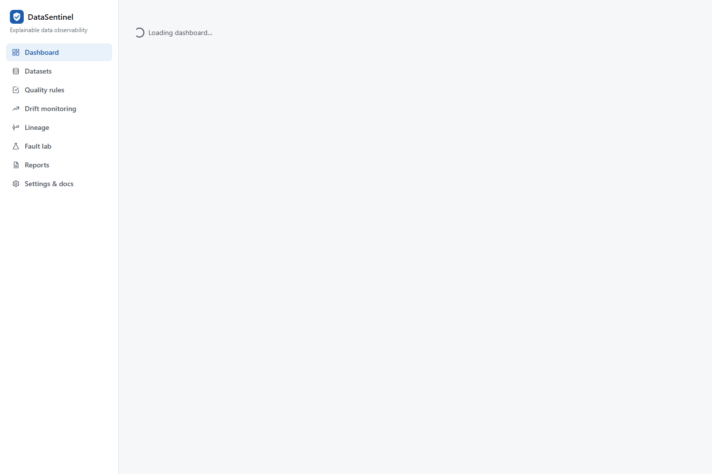
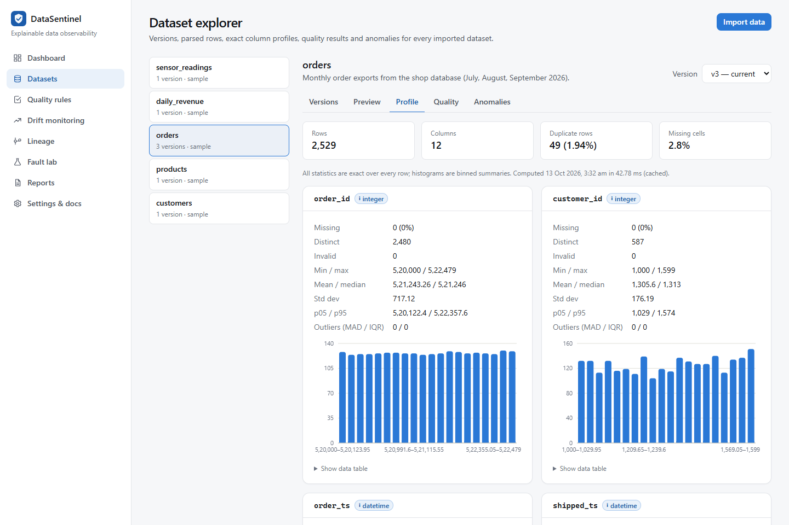
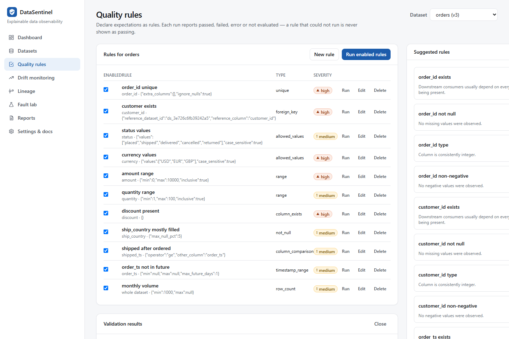
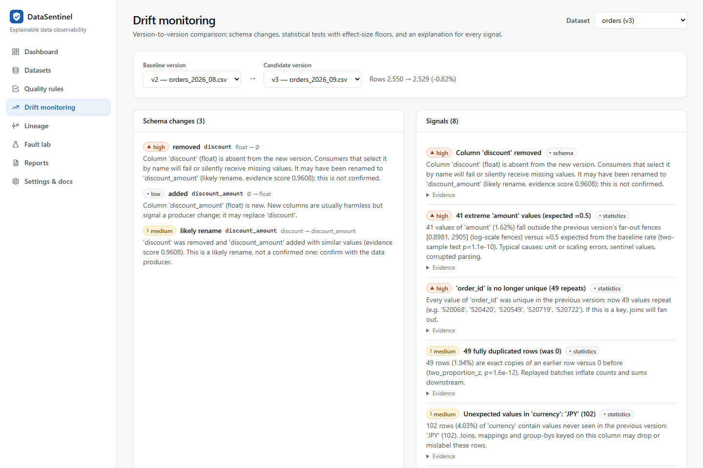
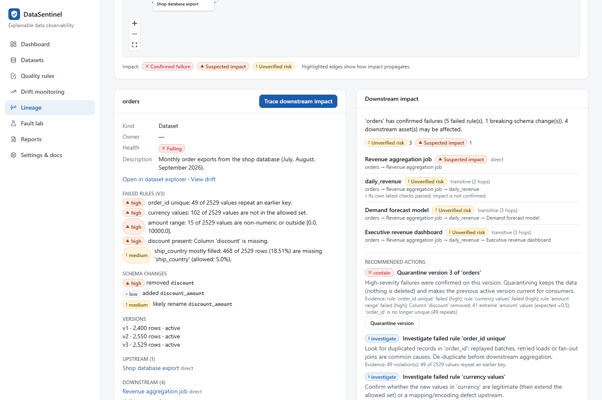
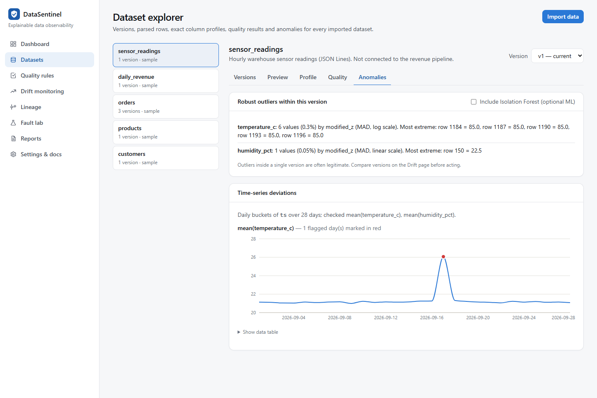
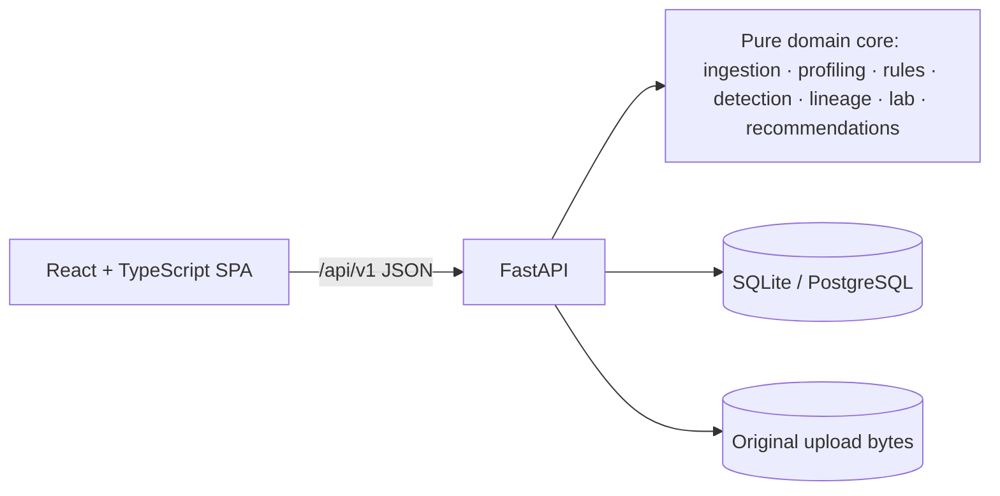

# DataSentinel

**Catch silent data failures before they corrupt your decisions.**

An explainable data observability platform for detecting data quality failures, schema drift,
statistical anomalies, and downstream pipeline impact.

DataSentinel imports CSV/JSON/JSON Lines datasets as immutable versions, profiles them exactly,
runs declarative quality rules, compares each version with the previous one using statistical tests
with effect-size floors, traces which downstream reports and models are at risk through a declared
lineage graph, and recommends evidence-backed recovery steps. A **fault-injection laboratory**
corrupts copies of your data in controlled, seeded ways and scores what the detectors caught against
hidden ground truth.

Everything runs locally. No data leaves your machine, and no paid service or AI model is involved.



## Highlights

* **Ingestion that never lies:** malformed rows are rejected *and reported* with line numbers;
  type inference counts invalid values instead of coercing them; every version keeps its SHA-256.
* **Exact profiling:** missing values, distinctness, quantiles, outliers, categories, date ranges.
* **12 rule types** with four honest statuses: a rule that could not run is `not_evaluated`, never `passed`.
* **Drift detection with explanations:** added/removed columns, *possible* renames (never claimed as
  confirmed), type and nullability changes, and two-proportion, Fisher, Kolmogorov–Smirnov and χ²
  tests that need both p < 0.001 and a practical effect.
* **Lineage and impact:** a declared DAG (cycles rejected with the path) where downstream assets are
  labelled *confirmed failure*, *suspected impact* or *unverified risk*, based on evidence.
* **Recommendations** that cite their evidence: quarantine (non-destructive), restore the last
  version that passed its rules, re-validate downstream, add missing rules.
* **Fault lab:** 10 seeded fault types, byte-identical regeneration, true/false positives and misses.
* **Reports** exportable as Markdown or JSON.

## Benchmark (measured, synthetic data)

280 seeded fault scenarios (10 faults × 3 intensities × 10 replicates) plus 20 healthy controls, on
seeds not used during development ([methodology, full results and run history](docs/benchmark.md)):

| | Statistics + declared rules | Statistics only |
|---|---|---|
| Recall, default intensity | **0.96** | 0.86 |
| Recall, all intensities (incl. deliberately sub-threshold) | 0.79 | 0.65 |
| False alarms on healthy controls | **0 / 20** | 0 / 20 |
| Signal precision | 1.00 | 1.00 |
| Schema drift accuracy | 1.00 | 1.00 |
| Rule violation counts exactly equal to injected rows | 77 / 77 | — |
| Detection latency (2,500 rows, median) | 124 ms | 77 ms |

Impact propagation matched an independent shortest-path implementation on 6,000 / 6,000 source
nodes. With only 20 healthy controls, 0 false alarms still allows a true false-positive rate up to
~15 %, and synthetic data is cleaner than real data. Treat these numbers as regression evidence,
not a promise.

## Quick start (Windows PowerShell)

```powershell
git clone https://github.com/<you>/datasentinel.git
cd datasentinel

# API (http://127.0.0.1:8000, docs at /api/v1/docs)
cd backend
py -3 -m venv .venv
.\.venv\Scripts\python.exe -m pip install -r requirements-dev.txt -r requirements-ml.txt
$env:DATASENTINEL_LOAD_SAMPLES_ON_STARTUP = "true"      # optional: preload the demo workspace
.\.venv\Scripts\python.exe -m uvicorn datasentinel.main:app --reload --port 8000

# UI (new terminal; http://localhost:5173)
cd frontend
npm ci
npm run dev
```

Or with Docker (API and UI on one port, demo preloaded): `docker compose up --build` →
http://localhost:8000. Details: [Windows setup](docs/setup-windows.md) ·
[deployment](docs/deployment.md) · [configuration](docs/configuration.md).

## Screens

| | |
|---|---|
|  Exact column profiles |  Rules with typed parameters and results |
|  Explained drift signals |  Lineage and impact |
|  Fault lab vs. ground truth |  Within-version anomalies (stuck sensor) |

All screenshots were captured from the running application with the bundled synthetic data.

## Architecture



The domain core performs no I/O, so the benchmark exercises exactly the code the API runs. More in
[docs/architecture.md](docs/architecture.md) and the [decision records](docs/adr/README.md).

**Stack:** Python 3.12–3.14, FastAPI, Pydantic, SQLAlchemy, Alembic, pandas, NumPy, SciPy, `regex`,
optional scikit-learn · React 19, TypeScript (strict), Vite, Tailwind CSS, React Flow, Recharts ·
pytest, Vitest, React Testing Library, Playwright · Docker, GitHub Actions.

## Tests

| Suite | Command | Result (2026-10-13) |
|---|---|---|
| Backend unit + API + integration | `python -m pytest` (in `backend/`) | 184 passed |
| Frontend components and pages | `npm test` (in `frontend/`) | 36 passed |
| Browser end-to-end (import → profile → rule → fault → detect → compare → impact → export) | `npx playwright test` | 1 passed |
| Lint / format / types | `ruff check`, `ruff format --check`, `npm run lint`, `npm run typecheck` | clean |

## Documentation

| Topic | |
|---|---|
| [Architecture & data flow](docs/architecture.md) | [Detection methodology](docs/methodology.md) |
| [Fault-lab walkthrough](docs/fault-lab.md) | [Benchmark](docs/benchmark.md) |
| [Synthetic data](docs/synthetic-data.md) | [API](docs/api.md) ([OpenAPI](docs/openapi.json)) |
| [Configuration](docs/configuration.md) | [Security & privacy](docs/security.md) |
| [Deployment](docs/deployment.md) | [Limitations](docs/limitations.md) |
| [Windows setup & troubleshooting](docs/setup-windows.md) | [90-second demo script](docs/demo-script.md) |

## Privacy

Uploaded data is stored only in the local data directory and is never sent to any external service.
It is kept until you delete it; generated fault-lab data expires after 24 hours by default.
DataSentinel has no authentication — run it locally or behind your own access control.

## License

[MIT](LICENSE). Runtime dependencies are under permissive licenses (MIT, BSD-3-Clause, Apache-2.0, PSF),
checked from package metadata. The optional PostgreSQL driver `psycopg` (`requirements-postgres.txt`)
is LGPL-3.0; it is used unmodified as a separately installed library, which is compatible with
distributing this project under MIT.
