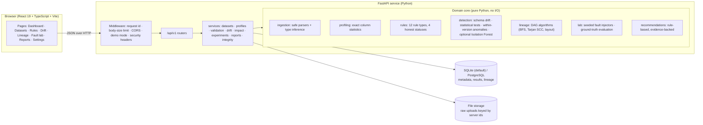
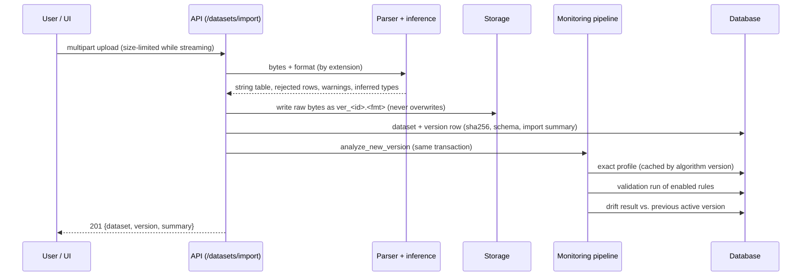
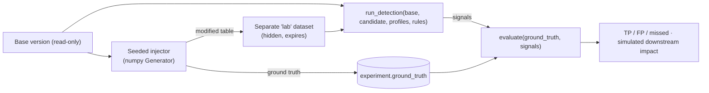

# Architecture

DataSentinel is a single FastAPI service with a React single-page app. Everything runs locally; no
external service, model or API is called.

## Component view

**Why this split.** The core packages (`ingestion`, `profiling`, `rules`, `detection`, `lineage`,
`lab`, `recommendations`) take tables and dictionaries and return dictionaries. They never touch the
database or HTTP, which keeps them unit-testable and lets the benchmark call exactly the same code
as the API. `services/` owns persistence and transactions; `api/` owns validation and HTTP shapes.

## Data flow: importing a version

If any step fails, the transaction rolls back and the stored file is deleted, so a version is never
visible without its analysis.

## Data flow: fault-injection experiment

`run_detection` has no parameter through which the experiment or its ground truth could reach it;
a unit test asserts its signature.

## Storage model

| Table | Purpose |
|---|---|
| `datasets` | Logical dataset (`kind`: user, sample, lab) |
| `dataset_versions` | One row per import: provenance, sha256, schema, import summary, status (active/quarantined) |
| `version_profiles` | Cached exact profile per version and algorithm version |
| `quality_rules` | Declarative rules with validated JSON parameters |
| `validation_runs`, `rule_results` | Every rule execution with counts, examples and recommendation |
| `drift_results` | Cached version-pair comparisons keyed by algorithm version |
| `lineage_assets`, `lineage_edges` | Declared DAG; every dataset is an asset automatically |
| `experiments` | Fault, seed, ground truth, detection output, evaluation |
| `reports` | Generated report content (JSON) |

Raw files are stored once, byte-for-byte, under server-generated keys; versions are re-parsed on
demand through a small in-process LRU cache. Storing the original bytes keeps provenance exact
(sha256 of what was uploaded) and avoids a columnar-format dependency; the trade-off is re-parsing
cost after a restart (about 0.5 s per 10k rows, measured in the benchmark).

## Health and impact semantics

| State | Meaning |
|---|---|
| `failing` | A rule failed, or a breaking schema change (column removed, high/critical type change) was detected — deterministic facts |
| `anomalous` | No failed rules, but medium+ statistical signals |
| `passing` | Rules ran and passed; no medium+ signals |
| `unvalidated` | No rules and no comparison yet |
| `no_checks` | Non-dataset assets (sources, jobs, reports, models) |

Downstream impact from an origin is labelled `confirmed_failure` (the asset's own checks fail),
`suspected_impact` (reads a failing origin directly, or has its own anomalies), `unverified_risk`
(further downstream, no own evidence) or `no_known_impact` (origin is not failing). Only declared
edges are followed.

See also: [methodology](methodology.md), [ADRs](adr/), [API](api.md).
