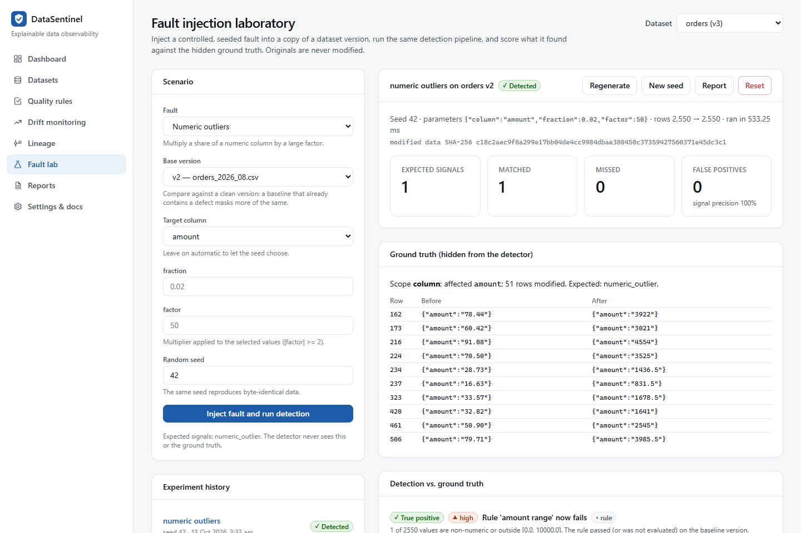

# Fault-injection laboratory walkthrough

The lab answers *"would DataSentinel have caught this?"* with evidence: it corrupts a **copy** of a
dataset version in a controlled, seeded way, runs the normal detection pipeline on it, and scores
the result against the ground truth it recorded while injecting.

## 1. Pick a dataset and a fault

Load the demo workspace, open **Fault lab** and choose `orders`. The catalogue lists ten faults; for
the chosen dataset each one shows the columns it can target:

| Fault | What it does | Expected signal |
|---|---|---|
| Missing-value injection | Blanks a share of a column | `null_rate_increase` |
| Duplicate records | Inserts exact copies of random rows | `duplicate_rows` |
| Numeric outliers | Multiplies a share of a numeric (non-identifier) column by a factor | `numeric_outlier` |
| Schema type change | Appends a unit suffix to numeric values (`12.50 USD`) | `type_change` (or `invalid_values` below 5 %) |
| Column removal | Drops a column | `column_removed` |
| Unexpected categories | Replaces a share of a categorical column with unseen values | `new_category` |
| Row-count reduction | Removes a share of rows | `row_count_change` |
| Timestamp corruption | Unparseable strings, 1970 epochs or year-2099 dates | `timestamp_invalid` / `timestamp_out_of_range` |
| Referential integrity | Replaces foreign-key values with non-existent ids | `referential_integrity` (needs a `foreign_key` rule) |
| Distribution shift | Shifts/rescales every value of a numeric column | `distribution_shift` |

## 2. Choose a base version, parameters and a seed

Pick a **clean base version**. The detectors compare the modified data with the base, so a base that
already contains a defect masks more of the same: on the demo, 2 % of ×50 `amount` errors are
detected against August (v2, p ≈ 7·10⁻⁶) but **not** against September (v3, p = 0.045), because v3
already contains the planted ×100 values. This is exactly why declared rules matter: the `amount
range` rule flags v3 regardless of what came before.

Leave *Target column* on automatic to let the seed choose, or pick one. The seed fully determines
the injected rows: **the same seed reproduces byte-identical data**, confirmed by the SHA-256 shown
with each result.

## 3. Read the result

* **Ground truth (hidden from the detector):** affected columns and rows, and a before/after table.
* **Detection vs. ground truth:** every signal labelled *true positive*, *false positive* or
  *context (not scored)*, plus any **missed** expected signal.
* **Before vs. after:** baseline-quantile histograms of the affected column, with explicit
  "below / above anything seen before" tail bins.
* **Simulated downstream impact:** what the declared lineage says would be affected if this data
  reached production.

## 4. Regenerate, reseed, reset, report

* **Regenerate** discards the generated data and re-runs with the same seed — the UI confirms the
  hashes match.
* **New seed** draws a different sample of rows.
* **Reset** deletes the experiment and its generated data. The original dataset is never modified;
  generated data lives in a separate hidden `lab` dataset and expires after
  `DATASENTINEL_EXPERIMENT_RETENTION_HOURS`.
* **Report** produces an exportable experiment report.

## Try these

Verified on the demo workspace (seeds 1–3; the v2 case with seed 1):

| Scenario | Outcome |
|---|---|
| `numeric_outliers` on `orders` **v2**, column `amount`, fraction 0.02, factor 50 | Detected by the outlier test; KS stays below its floor because only 2 % of values moved |
| Same fault on `orders` **v3** (the current version) | Missed — the baseline already contains the planted ×100 values (see above) |
| `missing_values` on `orders`, column `amount`, fraction 0.01 | Partially detected: `amount` was never empty before, so a *nullability change* fires, but the +1 percentage-point rise is under the 2 pp floor for the *null-rate* signal |
| `referential_integrity` on `customers` | Refused (422): no foreign-key column to corrupt |
| `referential_integrity` on `orders` | Detected only by the declared `foreign_key` rule; statistics alone cannot know which ids exist |
| `row_count_reduction` on `orders`, fraction 0.1 | Missed: −10 % is inside the ±20 % tolerance |

The [benchmark](benchmark.md) runs the same machinery across 280 seeded scenarios.
