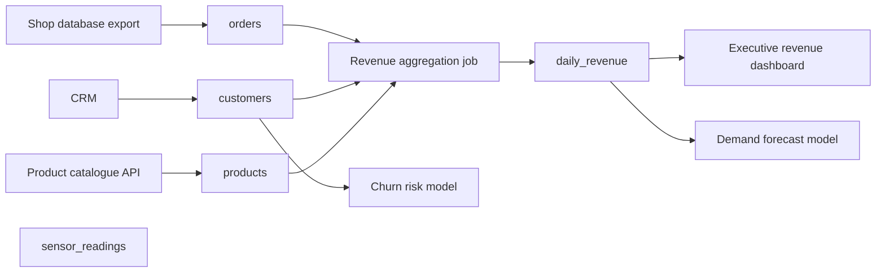

# Synthetic sample data

All bundled data is synthetic, generated by
[`backend/datasentinel/samples/generator.py`](../backend/datasentinel/samples/generator.py) with a
fixed seed (`20260701`). It contains no real people, companies or transactions; e-mail addresses use
the reserved `example.com` domain.

```powershell
cd backend
.\.venv\Scripts\python.exe -m datasentinel.samples.generator --check   # verify committed files are reproducible
.\.venv\Scripts\python.exe -m datasentinel.samples.generator           # regenerate
```

A test (`tests/test_samples.py`) asserts that the committed files are byte-identical to the
generator's output. NumPy does not promise identical random streams across every future release;
if an upgrade changes them, the test fails rather than the data silently changing.

| File | Format | Rows | Content |
|---|---|---|---|
| `customers.csv` | CSV | 600 | id, e-mail, country, segment, signup date, lifetime value (lognormal) |
| `orders_2026_07.csv` | CSV | 2,400 | July orders: id, customer id, order/ship timestamps, status, currency, quantity (geometric), unit price (lognormal), discount, amount, ship country |
| `orders_2026_08.csv` | CSV | 2,550 | August orders; adds a `channel` column (a benign schema change) |
| `orders_2026_09.csv` | CSV | 2,529 | September orders with **planted issues** (below) |
| `daily_revenue.csv` | CSV | 31 | Revenue per day derived from July orders |
| `products.json` | JSON array | 150 | Nested `dimensions` object (flattened to `dimensions.weight_kg`, `dimensions.fragile`) |
| `sensor_readings.jsonl` | JSON Lines | 2,016 | Hourly temperature/humidity for three devices over 28 days |

## Planted issues (what the demo should find)

These are deliberate and documented so that every finding in the demo can be checked:

| File | Planted issue | Detected by |
|---|---|---|
| `orders_2026_09.csv` | `ship_country` missing rate raised from ~1.5 % to ~18 % | null-rate test; `not_null` rule (max 5 %) |
| | currency `JPY` in ~4 % of rows | new-category detector; `allowed_values` rule |
| | `amount` × 100 in ~1.5 % of rows (cents vs. units) | outlier test; `range` rule; daily-mean time-series deviations |
| | ~2 % of rows duplicated | duplicate-rows test; `unique` rule; uniqueness lost on `order_id` |
| | `discount` renamed to `discount_amount` | column removed + added, reported as a *likely* (not confirmed) rename; `column_exists` rule |
| `sensor_readings.jsonl` | `sensor-b` stuck at 85.0 °C for six hours on 2026-09-17 | within-version outliers; time-series deviation on that day; `range` rule (−40…60 °C) |

The July → August comparison is a healthy control: its only finding is the added `channel` column.

## Demo workspace

`POST /api/v1/samples/load` (or the dashboard's *Load demo workspace* button) imports the files in
order, creates 21 quality rules and declares this lineage:



`sensor_readings` is intentionally disconnected to show that isolated assets are supported.
